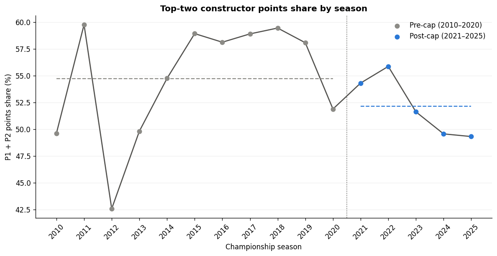

# Ashwin Pillanda Ravindra

**Business Intelligence Developer · MS in Business Analytics, Boston University Questrom · Boston, MA**

I build Power BI dashboards, SQL data models and automated reporting workflows. At Tata Consultancy Services (Aug 2021 – Aug 2026), I delivered 10+ dashboards and reports, migrated 6+ QlikView applications to Power BI, and automated Stellantis' fleet sales report, saving an estimated ~$80K (₹70 lakh) a year in manual work.

Seeking **Summer 2027 BI and analytics internships**.

**[Portfolio](https://ashwinpr15.github.io/) · [Resume (PDF)](https://ashwinpr15.github.io/assets/Ashwin-Resume.pdf) · [LinkedIn](https://www.linkedin.com/in/prashwin) · [Email](mailto:ashwinpr@bu.edu)**

<picture>
  <source media="(prefers-color-scheme: dark)" srcset="assets/banner-dark.svg">
  
</picture>

## Selected work

- **[Fleet Sales Reporting Automation](https://ashwinpr15.github.io/work/fleet-sales-reporting/)** (TCS, Stellantis). Automated the fleet sales report end to end, from data extraction to the final report, saving an estimated ~$80K (₹70 lakh) a year in manual work.
- **[QlikView to Power BI Migration](https://ashwinpr15.github.io/work/qlikview-power-bi-migration/)** (TCS). Rebuilt 6+ QlikView applications in Power BI, including their data models and reports.
- **[Formula 1 Cost Cap and Competitive Balance](https://github.com/ashwinpr15/BA780-F1-Cost-Cap)** (BU Questrom team project). After the 2021 cost cap, the top two teams' average points share fell 2.58 percentage points, and the comparison was inconclusive (p = 0.245). Covers 16 seasons, with an executed notebook, 15 charts and the presentation. [Case study](https://ashwinpr15.github.io/work/f1-cost-cap/) · Python, pandas, SciPy.

Client work at TCS is confidential, so those two case studies describe the work with illustrative diagrams and no client data.

## Other projects

- **[Headset Desk](https://github.com/ashwinpr15/headset-desk)**. A Windows 11 app for Sony WH-1000XM5 and WH-CH720N headphones, shipped with a CI-built installer. C++, Qt / QML, CMake.
- **[Quadruped Robot](https://github.com/ashwinpr15/Autonomous-Quadruped-Robot-for-Vision-Based-Navigation-and-IoT-Monitoring)**. My engineering capstone: a 12-servo, four-legged robot with camera-based navigation and IoT sensor monitoring. Raspberry Pi, OpenCV, Python.
- **ML labs** (small learning projects on synthetic data): [Signal Denoising](https://github.com/ashwinpr15/audio-signal-enhancement), [Random Forest Benchmark](https://github.com/ashwinpr15/healthcare-diagnostic-hub) and [Traffic Classifier](https://github.com/ashwinpr15/network-security-analytics).

## Skills

**Core:** SQL · Power BI · Snowflake · Python

- **Reporting** (professional, TCS): Power BI, Power BI Dataflows, QlikView, Qlik NPrinting, PowerApps
- **Data Modeling & ETL** (professional, TCS): SQL, Snowflake, Azure Data Factory, Apache Airflow, DB2, Microsoft Fabric, data modeling
- **Statistics & Analytics** (MSBA coursework and projects): Python (pandas, NumPy, SciPy), Welch t-tests, Jupyter, scikit-learn, TensorFlow
- **Engineering** (personal and academic projects): C++, Qt / QML, CMake, Raspberry Pi, OpenCV

## Experience

**Business Intelligence Developer, Tata Consultancy Services** · Bengaluru, India · Aug 2021 – Aug 2026

- Built 10+ dashboards and reports in Power BI and QlikView for sales, finance and supply chain teams at global clients including Stellantis, Samsung and Bosch.
- Developed PowerApps for data entry, approvals and write-back embedded in Power BI reports.
- Designed data models and SQL transformations on Snowflake, DB2 and Microsoft Fabric, and built pipelines with Azure Data Factory, Python and Airflow.
- Recognized with the Special Initiative Award (2024), Best Team Awards (2022, 2023) and On The Spot Award (2022).

## Education

- **MS in Business Analytics (STEM)**, Boston University, Questrom School of Business · Boston, MA · Expected December 2027
- **BE, Electronics & Communication Engineering (CS)**, SDM Institute of Technology, Visvesvaraya Technological University · 2021
