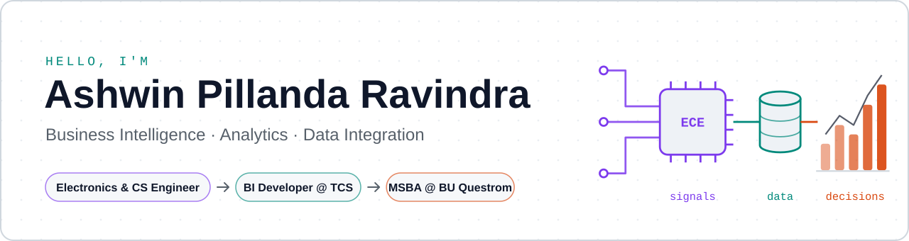
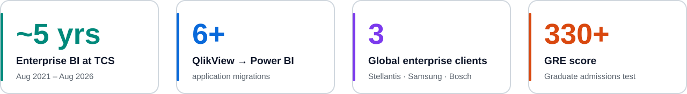
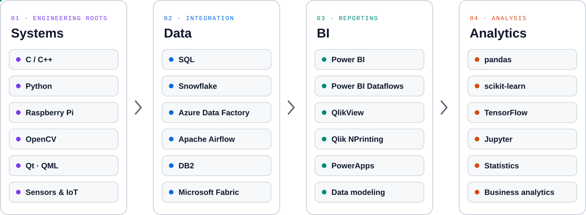
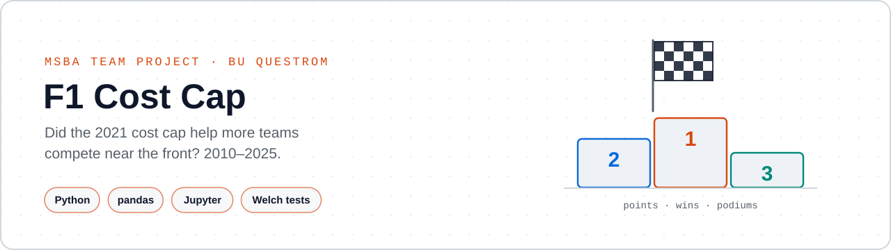
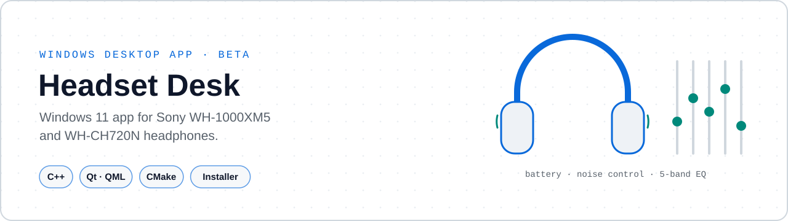
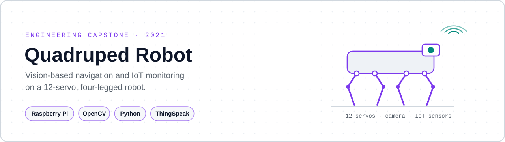
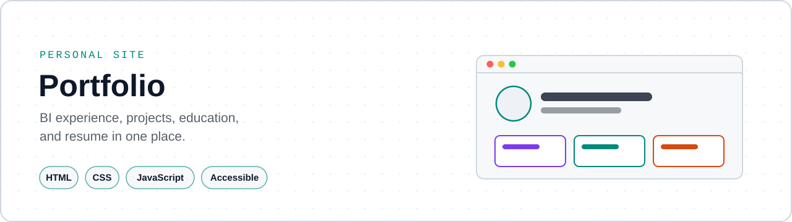

<picture>
  <source media="(prefers-color-scheme: dark)" srcset="assets/header-dark.svg">
  
</picture>

  <a href="https://ashwinpr15.github.io/"><picture><source media="(prefers-color-scheme: dark)" srcset="assets/btn-portfolio-dark.svg"></picture></a>
  <a href="https://in.linkedin.com/in/prashwin"><picture><source media="(prefers-color-scheme: dark)" srcset="assets/btn-linkedin-dark.svg"></picture></a>
  <a href="mailto:ashwinpr@bu.edu"><picture><source media="(prefers-color-scheme: dark)" srcset="assets/btn-email-dark.svg"></picture></a>
  <a href="https://ashwinpr15.github.io/assets/Ashwin-Resume.pdf"><picture><source media="(prefers-color-scheme: dark)" srcset="assets/btn-resume-dark.svg"></picture></a>

I started out wiring circuits and writing C++ as an **Electronics & Communication Engineering (with CS)** student, then worked as a **Business Intelligence Developer at Tata Consultancy Services**, building Power BI and QlikView dashboards, PowerApps and the SQL and Snowflake data models behind them for global clients. One report I automated saves Stellantis about **₹70 lakh a year** in manual work. I'm now an **MSBA student at Boston University's Questrom School of Business** in Boston, adding statistics and business analytics on top of that engineering and BI base.

<picture>
  <source media="(prefers-color-scheme: dark)" srcset="assets/impact-dark.svg">
  
</picture>

## Journey

<picture>
  <source media="(prefers-color-scheme: dark)" srcset="assets/journey-dark.svg">
  
</picture>

## Toolkit

<picture>
  <source media="(prefers-color-scheme: dark)" srcset="assets/toolkit-dark.svg">
  
</picture>

## Featured work

<table>
  <tr>
    <td width="50%" valign="top">
      <a href="https://github.com/ashwinpr15/BA780-F1-Cost-Cap"><picture><source media="(prefers-color-scheme: dark)" srcset="assets/proj-f1-dark.svg"></picture></a>
      <h3><a href="https://github.com/ashwinpr15/BA780-F1-Cost-Cap">Formula 1 Cost Cap</a></h3>
      Did the 2021 cost cap help more F1 teams compete near the front? An MSBA team analysis of 2010–2025 points, wins and podiums.  
      <code>Python</code> <code>pandas</code> <code>Jupyter</code> <code>Welch tests</code>
    </td>
    <td width="50%" valign="top">
      <a href="https://github.com/ashwinpr15/headset-desk"><picture><source media="(prefers-color-scheme: dark)" srcset="assets/proj-headset-dark.svg"></picture></a>
      <h3><a href="https://github.com/ashwinpr15/headset-desk">Headset Desk</a></h3>
      A Windows 11 app for Sony WH-1000XM5 and WH-CH720N headphones: battery, noise control, five-band EQ and a tray icon. Ships with an installer.  
      <code>C++</code> <code>Qt / QML</code> <code>CMake</code> <code>GitHub Actions</code>
    </td>
  </tr>
  <tr>
    <td width="50%" valign="top">
      <a href="https://github.com/ashwinpr15/Autonomous-Quadruped-Robot-for-Vision-Based-Navigation-and-IoT-Monitoring"><picture><source media="(prefers-color-scheme: dark)" srcset="assets/proj-robot-dark.svg"></picture></a>
      <h3><a href="https://github.com/ashwinpr15/Autonomous-Quadruped-Robot-for-Vision-Based-Navigation-and-IoT-Monitoring">Quadruped Robot</a></h3>
      My engineering capstone: a 12-servo, four-legged robot with camera-based navigation and IoT sensor monitoring, documented in a 35-page report.  
      <code>Raspberry Pi</code> <code>OpenCV</code> <code>Python</code> <code>ThingSpeak</code>
    </td>
    <td width="50%" valign="top">
      <a href="https://github.com/ashwinpr15/ashwinpr15.github.io"><picture><source media="(prefers-color-scheme: dark)" srcset="assets/proj-portfolio-dark.svg"></picture></a>
      <h3><a href="https://ashwinpr15.github.io/">Portfolio</a></h3>
      My experience, projects, education and resume in one place. Light and dark themes, keyboard friendly and mobile ready.  
      <code>HTML</code> <code>CSS</code> <code>JavaScript</code>
    </td>
  </tr>
</table>

### ML lab

Smaller learning projects on synthetic data, each with its scope and limits written up.

<table>
  <tr>
    <td width="33%" valign="top">
      <a href="https://github.com/ashwinpr15/audio-signal-enhancement"><picture><source media="(prefers-color-scheme: dark)" srcset="assets/proj-audio-dark.svg"></picture></a>
      <b><a href="https://github.com/ashwinpr15/audio-signal-enhancement">Signal Denoising</a></b> 
      Convolutional autoencoder · TensorFlow
    </td>
    <td width="33%" valign="top">
      <a href="https://github.com/ashwinpr15/healthcare-diagnostic-hub"><picture><source media="(prefers-color-scheme: dark)" srcset="assets/proj-forest-dark.svg"></picture></a>
      <b><a href="https://github.com/ashwinpr15/healthcare-diagnostic-hub">Random Forest Benchmark</a></b> 
      Model comparison · scikit-learn
    </td>
    <td width="33%" valign="top">
      <a href="https://github.com/ashwinpr15/network-security-analytics"><picture><source media="(prefers-color-scheme: dark)" srcset="assets/proj-network-dark.svg"></picture></a>
      <b><a href="https://github.com/ashwinpr15/network-security-analytics">Traffic Classifier</a></b> 
      Conv1D · leakage-free preprocessing
    </td>
  </tr>
</table>

## Education

- **MSBA, Business Analytics**: Boston University, Questrom School of Business · Sep 2026 – present · 16-month track
- **BE, Electronics and Communication Engineering with CS**: SDM Institute of Technology, Visvesvaraya Technological University (VTU) · 2021
- **GRE:** 330+

<picture>
  <source media="(prefers-color-scheme: dark)" srcset="assets/footer-dark.svg">
  
</picture>
